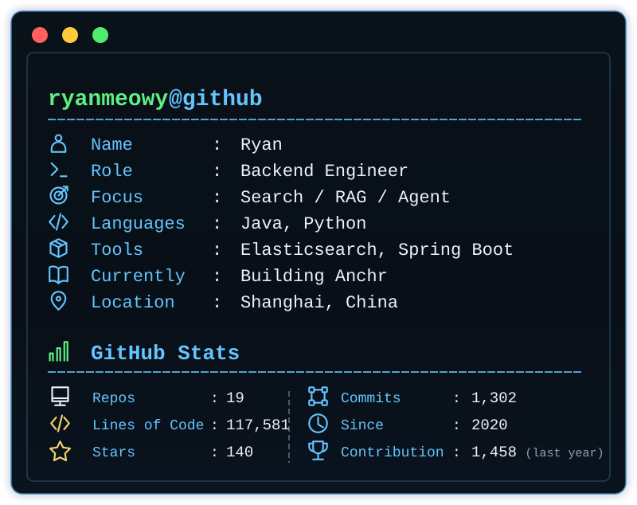

<table>
<tr>
<td valign="top">

## Hi, I'm Ryan 👋

Backend engineer. Most of my time goes into search and retrieval — the part
of the stack where you can't really hand-wave, because either the answer came
out of a document or it didn't, and anyone can go check.

That's shaped how I build. I'd rather measure retrieval than eyeball it, and I
want the reasoning visible instead of buried in a prompt. It also has to run on
a machine I control, which is a constraint I keep coming back to.

Java and Python, mostly, with Elasticsearch doing the heavy lifting when
search is the actual problem.

</td>
<td valign="top" width="400">

</td>
</tr>
</table>

## Anchr

A self-hostable workspace for your own documents. Hybrid search over everything
you've uploaded, answers with citations that resolve back to the passage they
came from, and an agent that does multi-step reading when one retrieval pass
isn't enough. There's an offline evaluation harness too, because "the model
produced text" is not the same thing as "the answer is in the document."

| Repository | What it is |
| --- | --- |
| **[anchr-app](https://github.com/ryanmeowy/anchr-app)** | Backend: hybrid retrieval, cited answers, agent runs. Java, Spring Boot, Spring AI, Elasticsearch |
| **[anchr-web](https://github.com/ryanmeowy/anchr-web)** | Browser workspace. Next.js, React, Tailwind |
| **[anchr-docling](https://github.com/ryanmeowy/anchr-docling)** | Turns PDFs and office documents into retrievable content. Python, Docling, FastAPI |
| **[anchr-eval](https://github.com/ryanmeowy/anchr-eval)** | Offline evaluation, checked against evidence. Python |

🌐 Live demo: **[anchr.cloud](https://anchr.cloud)**  ·  Blog: [ryanyang.cn](https://ryanyang.cn)
